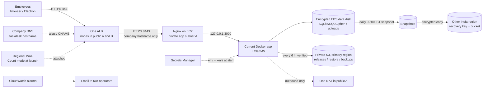
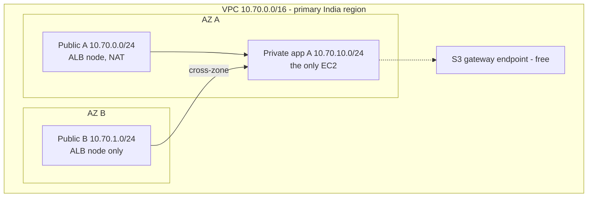

# Minimal architecture

What the sprint builds. It is the existing TaskDesk Docker app and its encrypted SQLite database, unchanged, on one private EC2 server in an approved India region, behind an HTTPS ALB with regional WAF. There is no PostgreSQL, no ECS, no CloudFront and no second app server.

## Request and data flow

## Network layout

There are three subnets. AZ B has only an ALB node. If AZ B fails, the app keeps working. If AZ A or the EC2 fails, the app is down until it is recovered from the disk or a snapshot (EC2 automatic recovery restarts the same instance on hardware faults).

## What runs where

| Component | Placement | Notes |
|---|---|---|
| ALB | Public A + B | TLS 1.2/1.3, HTTP→HTTPS 301, forwards only the company hostname (anything else gets 404), idle timeout 300 s for SSE |
| Regional WAF | Attached to the ALB | Known bad inputs block; common, SQL injection and IP reputation rules in **Count** until tuned |
| EC2 (c7i.xlarge default) | Private app A, no public IP | Ubuntu 24.04, Docker, Nginx on 8443, CloudWatch agent; admin only through Session Manager |
| Data EBS (gp3, encrypted) | AZ A | `/srv/taskdesk`, retained if the stack or instance is deleted |
| NAT gateway | Public A | Outbound only: packages, SMTP (Zoho 465), ClamAV updates, AWS APIs |
| S3 transfer bucket | Primary region | `releases/` (host reads), `restore/` (host reads), `backups/` (host writes, cannot delete); versioned, KMS, lifecycle |
| Snapshots | Primary + recovery region | Daily, 14 kept by default, crash-consistent (they supplement app backups and never replace them) |
| Recovery stack | Other India region | KMS key + versioned bucket; holds snapshot copies now and replicated backups later |
| Secrets Manager | Primary, replicated to recovery region | App env and SQLCipher keys; delivered to `/run` at start, never written to disk |

## Ports and access

| From | To | Port | Allowed by |
|---|---|---|---|
| `IngressCidr` (office IP at launch) | ALB | 80 → redirect, 443 | ALB security group |
| ALB | EC2 Nginx | 8443 | App SG accepts only the ALB SG |
| Nginx | App container | 3000 on 127.0.0.1 | Host loopback only |
| EC2 | Internet | Outbound | NAT; no inbound path |
| Operators | EC2 | none (Session Manager) | IAM; no SSH, no public IP |

## Alarms created by the stack

EC2 status check · no healthy target (site down) · app 5xx · ALB 5xx · p95 latency > 2 s · memory > 90% · root disk > 80% · data disk > 80% · no successful backup in 12 h · backup run failed. A separate budget alert sits in its own stack. All go to two email addresses.

## Limits accepted for the sprint

- One server and one AZ for the app. Not highly available.
- One SQLite writer. Never run a second app copy against the same or copied production data.
- 800-user capacity is a target, not a result. It is measured after deployment before wide rollout.
- Restore has been proven only by the cutover itself. An isolated restore drill with measured RTO/RPO comes after deployment.
- The WAF does not block the common rules yet. The app's own validation and ClamAV remain the real controls.
